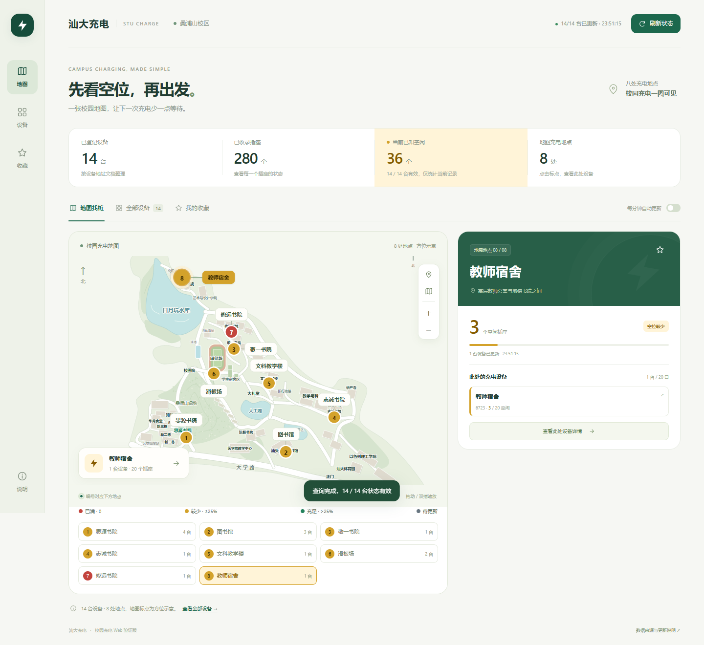

# 汕大充电 · STU Charge Watch

汕头大学校园电动车充电桩状态查看工具，包含 Web 版和可独立联网的 Android 版。当前 Android 版本为 **2.0.4**，支持 Android 8.0 及以上。

源码发布准备稿。第三方地图及参考数据的再分发授权仍需维护者确认；当前未为整个目录声明统一开源许可证，详见 [NOTICE.md](NOTICE.md) 和 [许可证说明](LICENSE-CHOICES.md)。

## 功能

- 14 台设备、280 个插座、8 处校园充电地点，名称与编号依据用户核对的设备照片整理。
- 地图选点、缩放、搜索、地点筛选、插座详情、收藏和本地备注。
- 红黄绿表示空闲比例：红色 0；黄色有空位且不超过 25%；绿色超过 25%；状态不完整时为灰色。
- 前台每 60 秒更新，最多同时查询两台，超过 120 秒的状态排除当前空闲汇总。
- Android 支持可选后台空位提醒；系统约每 15 分钟安排检查，实际时间受省电设置影响。



## 目录

```text
web/       Python 本地服务、网页、设备目录和校园方位图
android/   Java / WebView 安卓源码、资源和命令行构建脚本
tools/     从 Web 同步安卓页面和目录的工具
docs/      设备地址对照及界面截图
```

## 运行 Web

安装 Python 3.10 或以上，在项目根目录执行：

```sh
cd web
python server.py --port 8766
```

浏览器打开 <http://127.0.0.1:8766/>。Windows 也可双击 `web/启动Web验证版.cmd`。同一网络的手机可使用终端显示的局域网地址；Web 方式需要电脑服务持续运行。

当前查询服务由 Python 提供，GitHub Pages 无法运行该后端。公开 GitHub 仓库不会自动生成可实时查询的在线服务。

## 构建 Android

安装 Python 3、JDK 17、Android SDK Build Tools 35.0.0 和 Android 35 平台。参考 `android/toolchain.example.json`，把工具路径改为自己的安装路径并另存为 `android/toolchain.json`，然后从项目根目录执行：

```sh
python tools/sync_android_assets.py
cd android
python build.py --toolchain toolchain.json --work build --apk build/campus-charge-android.apk
```

构建脚本会在 `android/build/` 生成个人签名文件。保管并持续复用同一签名文件，才能对自己的 APK 覆盖升级；不要将私钥提交到仓库。当前已交付 APK 的签名私钥不包含在本准备包中。

Android 通过手机自身网络查询，无需电脑服务。应用的本地界面与地图随 APK 打包。

## 修改设备与页面

- 在 `web/data/catalog.json` 维护地点、设备名称、编号和示意坐标，保持 `locations[].device_ids` 与 `devices[].location_id` 一致。
- `web/data/device-locations.json` 保存照片说明与地点的来源记录，修改目录时同步维护。
- 修改网页或设备目录后，运行 `python tools/sync_android_assets.py` 更新安卓内置页面和 `Station.java` 的名称与编号。
- 同步工具保留安卓专用的 `android/assets/web/android.js`；不会把 Web 的 Service Worker 注册到安卓页面中。

设备全表见 [设备地址对照表](docs/设备地址对照表.md)。坐标是校园图中的方位示意，并非 GPS 经纬度。

## 数据与来源

设备参考及历史快照来自 [aiuanrou-hub/stu-charger](https://github.com/aiuanrou-hub/stu-charger)；设备名称与归属以用户照片说明为准。校园原图署名 Zagniki_，底图来源高德；本项目包含据此重绘的矢量示意图。素材授权情况见 [NOTICE.md](NOTICE.md)。

历史快照保持原始日期，不作为当前空闲状态。应用仅查询设备状态，不处理账户、订单、支付或启动充电。

## 验证与当前限制

已在桌面 Edge 的桌面与手机尺寸模拟中验证地图、名称、筛选、收藏、插座详情、颜色分界及过期显示；已检查 Android 构建、签名和资源打包。实体安卓设备的安装、WebView 生命周期、后台调度和系统通知投递仍待验证。平台接口变化可能需要后续适配。

## 发布

维护者的 GitHub 建仓、上传和 Releases 发布步骤见 [GitHub 发布指南](GitHub发布指南.md)。
